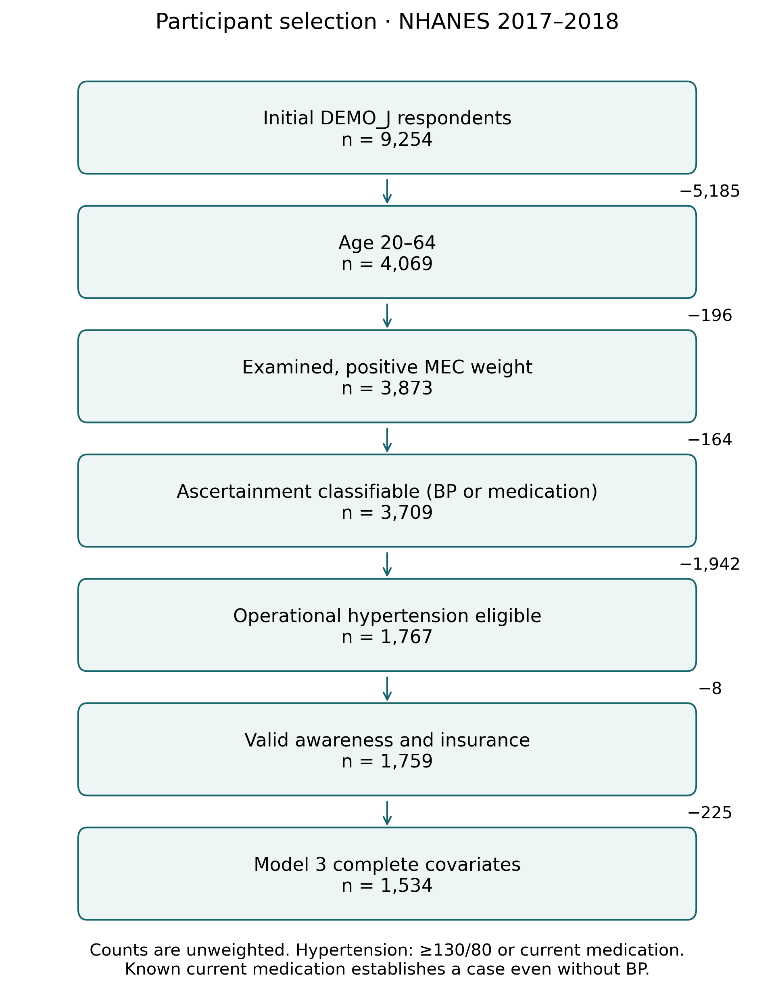
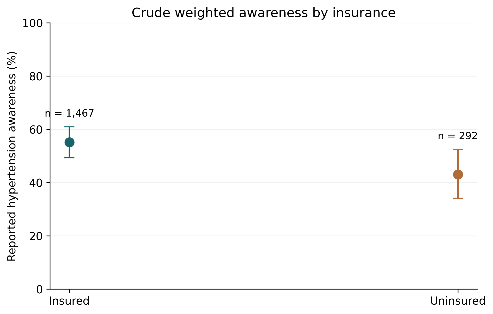
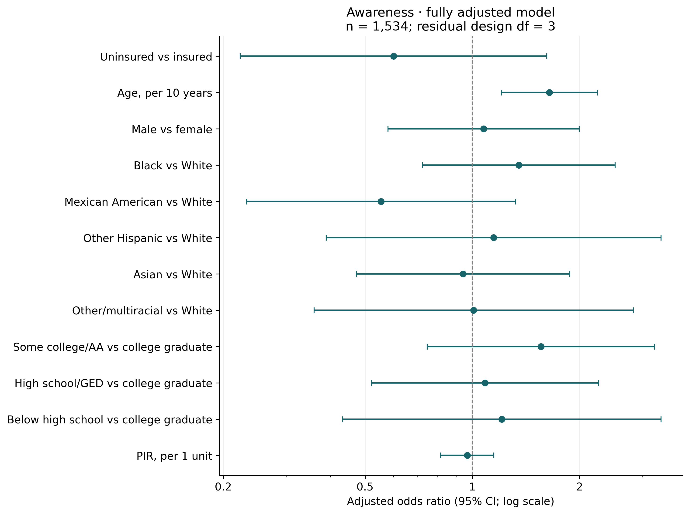
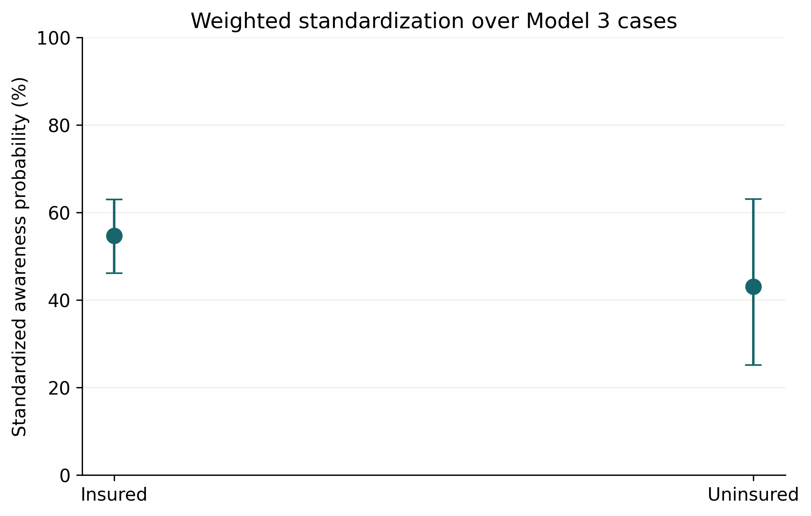
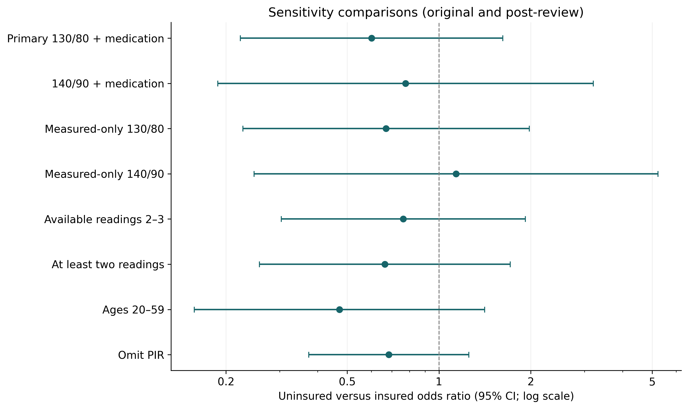

# Health Insurance Coverage and Hypertension Awareness Among U.S. Adults: A Survey-Weighted Analysis of NHANES 2017–2018

**Educational manuscript draft; not peer reviewed or submitted.** Analysis date: October 10, 2026. Applicant name and verified individual contributions must be supplied before external use. Computational development and writing were AI-assisted. This draft reports a retrospective, protocol-guided secondary analysis, not a prospectively preregistered study.

## Structured abstract

**Background:** Health insurance may facilitate recognition of hypertension through contact with healthcare, but current insurance and previous diagnosis are measured at different times. We examined their association while accounting for demographic and socioeconomic characteristics and alternative definitions of hypertension.

**Methods:** We analyzed the 2017–2018 National Health and Nutrition Examination Survey (NHANES). Examined adults aged 20–64 were classified as operational hypertension cases by mean systolic BP ≥130 mmHg, diastolic BP ≥80 mmHg or current prescribed medication; known medication cases did not require complete BP. Awareness was self-reported previous professional diagnosis; exposure was current insurance. R survey provided full-design domain inference and logistic adjustment for demographic/SES variables. Python/R Taylor calculations were compared. Post-review additions assessed ascertainment, missing PIR through response weighting with refitted JKn replicates, and inferential-reference sensitivity.

**Results:** The outcome/exposure-complete sample included 1,759 participants; Model 3 included 1,534. Awareness was 55.1% (95% CI 49.2–60.9) among insured and 43.1% (95% CI 34.2–52.4) among uninsured adults. The fully adjusted uninsured-versus-insured odds ratio was 0.60 (95% CI 0.22–1.62) (p=0.201; residual design df=3). The standardized uninsured-minus-insured awareness difference was -11.6 percentage points (95% CI -33.7–10.5). Sensitivity estimates were generally imprecise, with a direction reversal in the measured-only 140/90 domain.

**Conclusion:** The primary estimate was directionally compatible with lower awareness among uninsured adults but too imprecise to establish a clear adjusted association. Case selection, covariate missingness and limited survey degrees of freedom constrain interpretation. The analysis does not identify the causal effect of insurance coverage or establish clinically confirmed hypertension.

## Introduction

Hypertension awareness is an early step in a care process that also includes treatment and blood pressure control. A person cannot readily pursue condition-specific management if a previous clinical encounter has not communicated the diagnosis. However, survey measures of awareness are imperfect. Reporting that a professional once diagnosed high blood pressure is a statement about remembered clinical history. Elevated pressure during a standardized examination is a statement about physiology at that visit. Neither measurement alone establishes the complete history of hypertension care. A study that relates insurance to awareness therefore needs to define both the target population and the meaning of awareness before interpreting any association.

Current health insurance can affect affordability and the practical opportunity to obtain screening and follow-up. Coverage may also coexist with differences in employment, income, education, age, disability and patterns of healthcare use. Those differences can produce an association even if the causal contribution of coverage itself is uncertain. In addition, a previous diagnosis or its consequences may change employment and insurance eligibility. This creates a plausible reverse pathway from illness history to current insurance. Cross-sectional data cannot reliably order these processes. Our research question consequently concerns an adjusted association, rather than an intervention effect or an estimate of what would happen if insurance were provided.

We selected ages 20–64 to handle adult education consistently and avoid the strong insurance change at Medicare eligibility. The target is the historical civilian noninstitutionalized population represented by this examination sample, subject to measurement and complete-case restrictions.

Our primary hypothesis was that uninsured adults meeting an operational hypertension definition would have lower reported awareness than insured adults after adjustment for demographic and socioeconomic characteristics. The specific contribution is methodological transparency: a documented protocol, authentic cached files, explicit skip-pattern handling, full-design domain inference, independent statistical validation and sensitivity to medication-linked case selection. These elements are intended to demonstrate epidemiological reasoning and reproducible research. They do not justify a claim that the relationship between insurance and hypertension care is newly discovered.

## Related research

Egan and colleagues examined insurance-related gaps across hypertension awareness, treatment and control in earlier NHANES periods [1]. Duru and colleagues also studied insurance and hypertension monitoring and control using NHANES [2]. These publications establish that insurance-related hypertension care is an existing research area. CDC Data Brief 278 describes awareness by insurance and healthcare utilization in 2011–2014 [3]. Their estimates provide background rather than direct replication targets because survey years, age restrictions and hypertension definitions differ.

Muntner and colleagues studied changes in BP control through 2017–2018 [4]. Control and awareness occupy different stages of care and should not be substituted for one another. Calixte and colleagues evaluated routine healthcare access and hypertension awareness across 2011–2018 [5], supporting the relevance of usual care as a secondary exposure. We did not pool cycles or estimate trends. The focused literature review was based on verifiable abstracts, official reports and publisher metadata; it was not systematic and cannot establish that no closely overlapping study exists. Bibliographic details and evidence-access limits are documented separately.

## Methods

### Design, setting and data sources

This was a secondary cross-sectional analysis of NHANES 2017–2018 public-use data. We used DEMO_J demographics, BPX_J examination measurements, BPQ_J hypertension questionnaire, HIQ_J insurance and HUQ_J healthcare utilization. Files were merged by SEQN with assertions for unique identifiers, one-to-one merges, compatible component identifiers and preservation of the demographic row count. The separate 2017–March 2020 prepandemic release was not used. Official codebooks were cached with the raw XPORT files; component URLs, checksums and row counts are retained in machine-readable provenance [6].

The original demographic/BP analyses were audited and preserved. This protocol was written before executing the insurance extension, but related exploratory findings were already known. The study is retrospective, not preregistered, and has no independent confirmatory dataset. Version 2 changes are explicitly post-review.

### Participants and blood pressure

Revised primary eligibility required age 20–64, examination status, positive WTMEC2YR and ascertainable operational hypertension. A known elevated available mean or current medication establishes a case; complete BP is not required for medication-confirmed cases. Negative classification requires both below-threshold means and medication absent. Unresolved records remain missing. The submitted complete-BP restriction is retained as sensitivity. Review changes were made after seeing initial results and are exploratory, not prospective confirmation. The ascertainment-complete prevalence denominator is reported explicitly, with worst-case bounds among all examined target adults.

The NHANES protocol obtains repeated seated BP measurements after rest, with a fourth attempt available when needed. We calculated separate means of available first three systolic and diastolic readings. Valid zero diastolic values were retained. Tiny floating-point representations of numeric zero from XPORT decoding were normalized. We did not invent missing readings or extrapolate from other participants. Alternative reading rules used readings 2–3, all four available readings and a requirement of at least two systolic and two diastolic values. These sensitivities assess reasonable measurement choices; they do not create independent examinations or confirm persistent hypertension.

### Hypertension, awareness and exposure

Operational hypertension was mean SBP ≥130 mmHg, mean DBP ≥80 mmHg or current prescribed antihypertensive medication. BPQ050A indicates current medication; BPQ040A asks ever advised medication. A structurally missing BPQ050A was coded absent only for the documented no-diagnosis/no-advice paths. Other unknowns were preserved. A known elevated component or medication use establishes a positive OR even when another component is unknown; unresolved below-threshold/unknown-medication cases remain unclassifiable. Measured-only sensitivities define a different selected population, not a validated correction for medication-related selection.

Awareness was BPQ020 yes versus no, representing previous clinician-reported diagnosis as recalled by the participant. Current insurance was HIQ011 yes versus no; the analysis coefficient contrasted uninsured with insured. Refusal, don't-know and missing responses were excluded from analyses requiring that variable. We did not interpret skipped questions as uniformly negative or replace unknown awareness with no. HUQ030 defined no usual care place versus one or more places for secondary analyses. The binary insurance measure does not describe benefit generosity, duration of coverage, continuity or underinsurance.

### Covariates and conceptual model

Age was centered at 40 and expressed per decade; sex used NHANES female/male coding. Race/ethnicity retained six social categories with White reference, rather than implying biological mechanisms. Education retained four groups with college graduate reference. Continuous PIR ranged from zero to five, top-coded at five. Refused/unknown covariates were missing.

A conceptual diagram linked background characteristics to insurance and awareness, and insurance to usual care and screening. Usual care was therefore excluded from primary insurance adjustment as a possible intermediary. Illness, diagnosis and medication can also influence current coverage and case selection, so the diagram does not identify a causal effect. We examined omission of PIR because its temporal role is uncertain, quadratic age because linearity is an assumption, and categorical PIR because top coding and nonlinear relationships can matter. Adjustment was not chosen by automated significance screening.

### Descriptive and regression analysis

We defined the full positive-weight examination survey design before age or hypertension domain restriction. The design used WTMEC2YR, SDMVSTRA and SDMVPSU, with strata-specific nesting of masked PSUs and no finite population correction. Taylor linearization accounted for weighting, stratification and clustering. Out-of-domain observations retained their role in defining the design and contributed zero to domain influence. Lonely PSUs were configured to fail rather than silently impose a variance adjustment. Two-year weights were not divided because no cycles were combined [7].

Table 1 reports unweighted category counts, valid denominators and missing counts alongside survey-weighted estimates by insurance. BP remains missing for medication-confirmed cases without measurement. Categorical percentages use each variable’s nonmissing denominator. Proportion intervals use Korn–Graubard-type beta endpoints with effective-n cap and tested boundary/complement handling. Numeric NCHS screening considers n, effective n, interval width and df [8]. Flagged rows are suppressed in presentation but retained in audited outputs; screening is not agency clearance or a regression-validity test.

Model 1 included insurance alone; Model 2 added age and sex; Model 3 added race/ethnicity, education and PIR. Models used their own complete cases. Models 1 and 2 were also fit on the Model 3 sample to separate sample changes from adjustment. R svyglm with quasibinomial family was the primary inference implementation [9]. Odds ratios were exponentiated logistic coefficients, not risk ratios. Coefficient intervals and two-sided tests used model residual design degrees of freedom. The full design had 15 degrees of freedom, but adding covariates reduced the coefficient reference degrees of freedom substantially.

### Standardization, missingness and sensitivity

We averaged Model 3 predictions over its weighted complete-case covariate distribution at each insurance status. Joint Taylor linearization included uncertainty in coefficients and the empirical covariate mix. Primary marginal intervals use Model 3 residual df, matching the coefficient contrast; individual probabilities have logit-transformed bounded intervals. Full-design-df coefficient intervals are separately labeled reference sensitivities. R JKn replicates independently refit the model and re-average predictions under each replicate. These standardizations remain descriptive and model-dependent; neither method identifies an insurance intervention effect.

We report missing counts, weighted missingness, common-sample models and retained/excluded profiles. A post-review PIR response-weighting sensitivity targets cases with complete outcome/exposure and non-PIR adjustment variables. Its weighted logistic response model includes insurance×awareness, quadratic age, sex, race/ethnicity, education, auxiliary BP with missingness flag, usual care and log examination weight. Complete-PIR cases receive MEC weight divided by estimated response probability. Auxiliary BP fills are nuisance predictors only, not substituted analytic measurements. Thirty stratified JKn replicates refit auxiliary means, response and outcome models, propagating estimated-weight uncertainty. Interpretation requires PIR MAR conditional on these predictors, positivity and adequate models; missing education and MNAR remain unresolved. No multiple imputation is claimed.

Original-protocol sensitivities compare thresholds, measured-only ascertainment, reading rules, age limits, pregnancy exclusion, functional forms, omit-PIR and usual care. Reviewer additions admit known treated cases without BP in primary eligibility, retain the old BP-complete restriction, contrast currently uninsured with currently insured reporting no past-year lapse (HIQ210=2), assess unknown ascertainment bounds, missing-PIR response weighting and alternative df calibration. Uninsured HIQ210 skips are not recoded as continuous coverage. These restrictions do not recover coverage at diagnosis. No multiplicity correction or significance-driven subset selection was applied.

### Independent validation and reporting

Python supplied source processing, modular code, tests and independent weighted-score/Taylor calculations. Ordinary statsmodels covariance was never used for reported survey inference. R independently read the raw XPORT components to reconstruct core variables and then used svydesign, subset, svymean, svyby and svyglm. Comparisons included coefficients, standard errors, sample sizes, degrees of freedom and marginal estimates, using prespecified numerical tolerances. Tight convergence tolerances resolved negligible secondary-model differences without changing specifications. Reporting follows the cross-sectional STROBE checklist, with a repository crosswalk [10].

## Results

### Participant selection and descriptive estimates

The source contained 9,254 respondents, of whom 4,069 were aged 20–64. The examined target included 3,873 adults, of whom 3,709 had classifiable operational hypertension status using available BP or current medication. Operational hypertension eligibility included 1,767; 8 lacked valid awareness or insurance. The outcome/exposure-complete sample contained 1,759 adults. Figure 1 and sample_flow.csv show sequential counts. There were 164 examined adults with unresolved ascertainment, including one BP-complete adult with unknown medication and below-threshold BP. Revised eligibility admits 35 current-medication cases without complete BP. These are post-review changes; the submitted BP-complete model is preserved as sensitivity.

Weighted operational hypertension prevalence among ascertainment-classifiable examined adults was 42.4% (95% CI 39.4–45.5) (n=3,709). Awareness among hypertension-eligible adults with valid awareness was 53.3% (95% CI 48.2–58.4) (n=1,762), while insurance-specific denominators were 1,467 insured and 292 uninsured. Awareness was 55.1% (95% CI 49.2–60.9) and 43.1% (95% CI 34.2–52.4), respectively. These outcome-specific estimates do not all use the same denominator.

### Table 1. Study population by insurance

[Full Table 1 with category counts, variable-specific denominators and missingness](TABLES.md).

Percentages are weighted; Category counts, valid denominators and missing counts are unweighted and printed separately. Composition denominators are variable-specific and recorded in table1.csv. †Fails NCHS numeric reliability screening; estimates and flags are retained in machine-readable outputs for audit. No baseline significance-screening tests were conducted.

### Adjusted models and absolute estimates

Model 1 produced uninsured-versus-insured OR 0.62 (95% CI 0.41–0.94) (p=0.027); Model 2 produced 0.69 (95% CI 0.43–1.11) (p=0.112). Model 3 produced aOR 0.60 (95% CI 0.22–1.62) (p=0.201), based on 1,534 cases with 847 aware outcomes and 687 unaware outcomes. Model 3 residual reference degrees of freedom were 3, compared with 14 and 12 for Models 1 and 2.

| Model | N | Uninsured OR (95% CI) | Residual df |
| --- | --- | --- | --- |
| M1 | 1,759 | 0.62 (95% CI 0.41–0.94) | 14 |
| M2 | 1,759 | 0.69 (95% CI 0.43–1.11) | 12 |
| M3 | 1,534 | 0.60 (95% CI 0.22–1.62) | 3 |
| M1_common | 1,534 | 0.57 (95% CI 0.34–0.95) | 14 |
| M2_common | 1,534 | 0.64 (95% CI 0.35–1.16) | 12 |

Standardized awareness probability was 54.7% (95% CI 46.1–62.9) for insured and 43.1% (95% CI 25.2–63.0) for uninsured status in the weighted Model 3 covariate distribution. The difference was -11.6 percentage points (95% CI -33.7–10.5). These primary marginal intervals use 3 model residual reference df, matching coefficient inference, with joint distribution/model linearization. Individual probabilities use logit-transformed bounded intervals. Full-design-df coefficient calibration is a separate reference sensitivity, not a new variance estimate.

### Missingness, ascertainment and diagnostics

Model 3 excluded 225 outcome/exposure-complete participants for covariate missingness. Its weighted retention was 89.3%. In the broader hypertension-eligible domain, PIR was missing for 226 participants (10.7% of weighted cases). Included and excluded profiles, common-sample coefficients and awareness bounds are retained in separate output files; they do not eliminate nonresponse bias.

The primary model converged, had rank 13, prediction range 0.102–0.837, weighted information condition number 535.0, maximum weighted leverage 0.107 and positive minimum covariance eigenvalue. No individually tabulated Model 3 category had zero outcomes; the smallest category had 85 cases. Insurance-by-category cells were smaller: the minimum contained 12 cases with as few as 2 aware outcomes. All categorical levels were present in both insurance groups, but marginal standardization remains model-dependent and small cells limit support. This check does not rule out sparsity in combinations of categories. All 30 delete-one-PSU fits converged; uninsured log-odds coefficients ranged from -0.712 to -0.318, showing design-unit influence even though no deletion reversed the primary direction.

Among BP-below-threshold medication-only cases with valid insurance/awareness, there were 242 insured and 17 uninsured adults. All reported awareness, illustrating the questionnaire/ascertainment linkage rather than proving absence of bias.

### Original-protocol and post-review sensitivity analyses

| Specification | N | Uninsured OR (95% CI) |
| --- | --- | --- |
| threshold140 | 998 | 0.78 (95% CI 0.19–3.20) |
| measured130 | 1,279 | 0.67 (95% CI 0.23–1.98) |
| measured140 | 573 | 1.14 (95% CI 0.25–5.23) |
| readings23 | 1,533 | 0.76 (95% CI 0.30–1.92) |
| readings1234 | 1,531 | 0.62 (95% CI 0.23–1.66) |
| two_readings | 1,471 | 0.66 (95% CI 0.26–1.71) |
| age20_59 | 1,151 | 0.47 (95% CI 0.16–1.41) |
| age30_64 | 1,437 | 0.61 (95% CI 0.21–1.78) |
| bp_complete | 1,503 | 0.59 (95% CI 0.21–1.63) |
| insured_no_lapse | 1,421 | 0.62 (95% CI 0.24–1.64) |
| exclude_pregnant | 1,533 | 0.60 (95% CI 0.22–1.61) |
| omit_pir | 1,758 | 0.68 (95% CI 0.37–1.25) |
| quadratic_age | 1,534 | 0.61 (95% CI 0.15–2.37) |
| categorical_pir | 1,534 | 0.62 (95% CI 0.18–2.10) |

The measured-only 130/80 estimate was 0.67 (95% CI 0.23–1.98); the measured-only 140/90 estimate was 1.14 (95% CI 0.25–5.23), reversing the primary point-estimate direction. Thus direction was not invariant across all case definitions, and imprecision precluded firm sensitivity conclusions. The secondary no-usual-care association was 0.55 (95% CI 0.31–0.96); after also including insurance it was 0.60 (95% CI 0.27–1.31). These exploratory coefficients are not causal or mediation effects, and no multiplicity correction supports significance-based interpretation.

### Post-review missingness, ascertainment and inference checks

Weighted worst-case ascertainment bounds among all 3,873 examined target adults were 40.9–44.6% for operational hypertension prevalence and 49.2–53.8% for awareness when unresolved cases/outcomes were assigned feasible extremes. These are identification sensitivity endpoints conditional on the observed examination sample, not a combined confidence interval or a bound on clinical truth. They do not account for examination nonparticipation.

The missing-PIR response-weighting sensitivity targeted 1,758 outcome/exposure- and non-PIR-covariate-complete cases, of whom 224 had missing PIR; 1 case still lacked another required covariate. It yielded uninsured OR 0.66 (95% CI 0.29–1.51). Response probabilities ranged 0.586–0.972, maximum inverse response factor was 1.71, and Kish effective weight n was 644.5 (a weight-dispersion diagnostic, not full survey-design effective n). All 30 JKn replicates refit auxiliary means, response and outcome models. The sensitivity assumes PIR MAR conditional on observed predictors and response positivity; neither is established by the observed records, and no independent Python response-weighting verification is claimed.

For primary nonlinear standardization, independently refit R JKn/Taylor SE ratios ranged 1.001–1.018; this is reassuring diagnostic agreement, not exact equivalence. Retaining identical Model 3 coefficients/SE but using full design df gave OR 0.60 (95% CI 0.31–1.17). The conservative residual-df analysis remains primary; neither calibration establishes a clear adjusted association.

### Validation and figures

Independent raw coding checks passed for 16 core variables. Python/R comparisons passed for 235 coefficient rows, 4 descriptive rows, 40 Table 1 rows and 3 marginal estimates; every R regression mask was rebuilt independently and 2,969 full covariance entries compared. The automated test outcomes are recorded in outputs/test_results.json. Agreement concerns coding and numerical inference, not the correctness of every epidemiological assumption.

Figure captions and interval conventions: figures/CAPTIONS.md. All figures have 300-DPI PNG and vector PDF versions.

## Discussion

The primary point estimate was compatible with the hypothesized lower awareness among uninsured adults. Its uncertainty, however, included substantially lower odds, no association and higher odds. A clear adjusted association is not established by this dataset and model. The unadjusted insurance contrast was more precise, but it is not a substitute for the prespecified adjusted analysis. Age/sex adjustment, further covariate adjustment and sample selection changed estimates and uncertainty. Logistic OR noncollapsibility also changes marginal versus conditional odds contrasts even without confounding; common-sample comparisons remove only the sample-change component. Those changes should be interpreted as consequences of differing models and samples, rather than a contest to select whichever result looks strongest.

The conservative residual reference is important to interpretation, but it should not be mistaken for a literal loss of sampling units or proof of overfitting. R survey documentation supports this convention while noting that it can be conservative for individual-level predictors. We therefore retained it as primary and reported design-df calibration without choosing a reference by significance. The primary model still has 30 masked PSUs and 15 full design df; retaining specified race/education categories avoids outcome-driven pooling. Neither calibration establishes a clear adjusted association.

Medication inclusion creates a particularly consequential interpretive problem. Awareness and medication are not independent questionnaire constructs: medication questions follow diagnosis-related paths, and treated participants with below-threshold BP enter the medication-inclusive domain. Insurance may influence treatment and therefore entry into this component of the study sample. An apparent awareness difference can reflect both recognition and how cases are assembled. Restricting cases to elevated measured BP reduces that definitional linkage, but removes some aware adults whose treatment controlled their pressure. It can thereby create another selected population. The two domains offer complementary views, not an automatic bias correction.

The threshold sensitivity likewise changes case composition. Lower measured thresholds include people whose pressure may not previously have prompted diagnosis under older clinical practice, whereas higher thresholds select a smaller group with different severity and treatment histories. A historical prior-diagnosis item cannot be expected to correspond exactly to every operational examination cutoff. The measured-only 140/90 result therefore deserves reporting even though it does not match the primary direction. Its wide interval prevents a firm inference that insurance is associated with greater awareness in that restricted group.

Missing income remains consequential. The response-weighting result is a useful sensitivity under a different missingness assumption and approximates a broader covariate-complete target than the primary complete-case model. Refitting its nuisance model in sampling-unit replicates prevents treating estimated weights as fixed. Moderate observed inverse response factors do not establish positivity in unobserved combinations, correct specification or MAR. MEC weights cannot be assumed to address later item nonresponse. Complete-case versus response-weighted differences therefore are not a validated estimate of missing-data bias.

Earlier studies provide context [1–3], not exact replication targets. Differences in years, age, threshold and ascertainment can change estimates. The contribution is transparent tracing of estimands and uncertainty, including inconclusive results, rather than novelty.

## Strengths

The project uses authentic sources, a preserved submission snapshot and explicit post-review amendments. R reconstructs core variables and every regression domain from raw components; equivalent full Taylor covariance matrices are compared, not just diagonal SE. Nonlinear standardization is additionally assessed with independently refitted R JKn replicates. Tests address skip logic, missing classification, full-design variance, reliability edges and stale validation. Reproducible computed tables and writing expose inconclusive estimates. These strengths establish implementation checks, not novelty or absence of epidemiologic bias.

## Limitations

Cross-sectional measurement prevents secure temporal ordering. Current insurance may have begun after diagnosis, and hypertension-related illness may influence work or eligibility, creating reverse causation. Residual confounding remains because geography, occupation, coverage history, comorbidity, health literacy and structural access are incompletely measured or not included. A conceptual diagram cannot remove those unmeasured pathways. Awareness is self-reported and may reflect recall, communication or interpretation of a professional encounter rather than factual diagnostic records.

Repeated readings at one visit improve within-visit measurement but do not confirm chronic hypertension. Physiological variation and examination context can produce classification error. Medication use is self-reported and linked to diagnosis questions; conditioning on operational hypertension may induce selection and definitional bias. Requiring complete BP and then complete covariates adds further selection. The pregnancy sensitivity only excludes known pregnancy and cannot establish absence of pregnancy for unknown respondents. These issues affect how far estimates can be generalized beyond the observed domains.

CDC documented declining response and sampled-location differences in 2017–2018, incorporated enhanced income/education calibration, and recommended combining earlier cycles to reduce remaining representation error [11]. Released weights are used here, but this requested single-cycle study cannot independently remove residual unit nonresponse or location-related error. The historical cycle does not describe current coverage or practice. The binary exposure collapses potentially important insurance types and coverage quality. Linear age and PIR terms may not adequately capture confounding, although specified alternative forms were examined. Sparse categories, highly variable weights and only 30 masked PSUs constrain model stability and precision. Numerical agreement establishes implementation consistency, not freedom from all epidemiological bias. Qualified methodological review and a fuller literature search are needed before considering publication.

## Conclusion

This reproducible NHANES analysis generated a directionally lower primary awareness estimate for uninsured adults, accompanied by substantial adjusted uncertainty and sensitivity to case definition. It demonstrates transparent epidemiological analysis rather than proof of a coverage effect. Further work should address covariate missingness, longitudinal ordering, case ascertainment and design-limited precision. The appropriate portfolio claim is an audited, independently validated secondary analysis and manuscript draft, with limitations and AI-assisted contributions disclosed.

## Authorship, funding and ethics reporting

This is an AI-assisted public-data research-training draft. Applicant contributions, funding, conflicts and institutional review requirements must be supplied and verified before submission. NHANES obtained its own participant consent/[ethics review](https://www.cdc.gov/nchs/nhanes/about/erb.html); this repository does not claim the applicant obtained an exemption or approval. No sponsor, faculty supervision or peer review was supplied.

## References

1. Egan BM, Li J, Small J, Nietert PJ, Sinopoli A. The growing gap in hypertension control between insured and uninsured adults: NHANES 1988 to 2010. Hypertension. 2014;64:997–1004. [doi:10.1161/HYPERTENSIONAHA.114.04276](https://doi.org/10.1161/HYPERTENSIONAHA.114.04276).
2. Duru OK et al. Health insurance status and hypertension monitoring and control in the United States. Am J Hypertens. 2007;20:348–353. [doi:10.1016/j.amjhyper.2006.11.007](https://doi.org/10.1016/j.amjhyper.2006.11.007).
3. CDC/NCHS. Characteristics of U.S. Adults With Hypertension Who Are Unaware of Their Hypertension, 2011–2014. Data Brief 278. 2017. [Official report](https://www.cdc.gov/nchs/products/databriefs/db278.htm).
4. Muntner P et al. Trends in blood pressure control among US adults with hypertension, 1999–2000 to 2017–2018. JAMA. 2020;324:1190–1200. [doi:10.1001/jama.2020.14545](https://doi.org/10.1001/jama.2020.14545).
5. Calixte R, Chahal K, Besson A, Kaplan MS. Access to routine health care and awareness of hypertension status among adults: Results from NHANES, 2011–2018. Preventive Medicine. 2024;179:107843. [doi:10.1016/j.ypmed.2023.107843](https://doi.org/10.1016/j.ypmed.2023.107843). Metadata verified against the [author institution record](https://researchconnect.suny.edu/en/publications/access-to-routine-health-care-and-awareness-of-hypertension-statu/).
6. CDC/NCHS. [NHANES 2017–2018 component data and documentation](https://wwwn.cdc.gov/nchs/nhanes/search/DataPage.aspx?Cycle=2017-2018). Individual codebooks and hashes in data/source_manifest.json and outputs/provenance.json.
7. CDC/NCHS. [Weighting tutorial](https://wwwn.cdc.gov/nchs/nhanes/tutorials/weighting.aspx) and [variance-estimation tutorial](https://wwwn.cdc.gov/nchs/nhanes/tutorials/varianceestimation.aspx).
8. Parker JD et al. National Center for Health Statistics data presentation standards for proportions. Vital Health Stat 2(175). 2017. [Revised report](https://www.cdc.gov/nchs/data/series/sr_02/sr02_175.pdf).
9. R survey package 4.5, help and implementation for svydesign, svyglm, svymean and svyciprop. [CRAN](https://cran.r-project.org/package=survey). Exact installed version and dependencies recorded in outputs/R_sessionInfo.txt.
10. STROBE. [Cross-sectional reporting guidance](https://www.strobe-statement.org/). Study-specific crosswalk in docs/STROBE_CHECKLIST.md.

11. CDC/NCHS. [An investigation of nonresponse bias and sample characteristics in NHANES 2017–2018: official summary](https://wwwn.cdc.gov/nchs/data/nhanes/analyticguidelines/17-18-sampling-variability-nonresponse-508.pdf). Enhanced released weights and recommendation for pooling earlier cycles.
