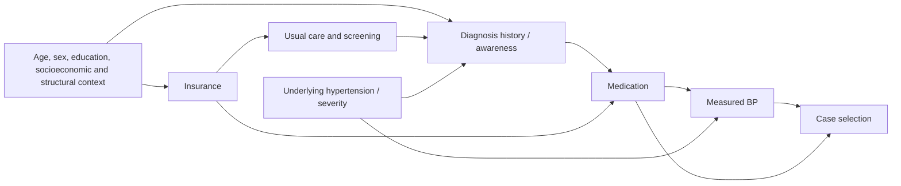

# Research protocol

**Health Insurance Coverage and Hypertension Awareness Among U.S. Adults: A Survey-Weighted Analysis of NHANES 2017–2018**

Version 1, October 10, 2026 (America/Chicago). Written before executing the new insurance analysis. Prior demographic/BP exploratory analyses already exist and have been audited. This is a retrospective protocol, not prospective preregistration; no independent confirmatory dataset is reserved. Amendments will be recorded in docs/AMENDMENTS.md.

## Background and focused literature
Hypertension recognition precedes treatment but diagnosis history and current BP are distinct. Insurance may facilitate contact with care; illness can also change insurance eligibility. Insurance/awareness associations are established research topics. Egan et al., *Hypertension* (2014), studied insured/uninsured adults aged 18–64 across earlier NHANES cycles and reported gaps across the care cascade ([PubMed](https://pubmed.ncbi.nlm.nih.gov/25185135/)). CDC Data Brief 278 describes insurance and awareness in 2011–2014 ([CDC](https://www.cdc.gov/nchs/products/databriefs/db278.htm)). Muntner et al., *JAMA* (2020), contextualizes the historical 2017–2018 period ([paper](https://pmc.ncbi.nlm.nih.gov/articles/PMC7489367/)). Calixte et al., *Preventive Medicine* (2024), addresses routine care and awareness in 2011–2018 ([publisher](https://www.sciencedirect.com/science/article/pii/S0091743523004292)). This focused review is not systematic; contribution is reproducible one-cycle estimation and explicit ascertainment sensitivity, not a novelty claim. Full evidence details are in docs/LITERATURE_REVIEW.md.

## Question, hypothesis and target
Among civilian noninstitutionalized U.S. adults aged 20–64 meeting an operational hypertension definition, is no current health insurance associated with lower reported hypertension awareness after demographic and socioeconomic adjustment? Hypothesis: uninsured adults have lower awareness. Association, not causal effect. Two-sided intervals and tests; no outcome-driven subgroup searches.

## Measurement and eligibility
Use only DEMO_J, BPX_J, BPQ_J, HIQ_J and HUQ_J from the 2017–2018 release. Left merge on unique SEQN into DEMO_J with one-to-one assertions. Retain the full positive-weight MEC design before constructing age and outcome domains. WTMEC2YR, SDMVSTRA and SDMVPSU are the design variables; no cycle pooling or weight division.

Primary BP is the separate mean of available first three valid systolic/diastolic readings. DBP zero remains valid, as documented; tiny XPORT floating representations of zero are normalized. The fourth attempt is reserved for sensitivity. Require both SBP and DBP for primary measurement availability, including treated adults, to make the measurement-complete population explicit. This excludes treated adults lacking BP and can bias ascertainment; sensitivity admits medication-confirmed cases without BP.

Operational hypertension: mean SBP ≥130 or DBP ≥80 or current prescribed antihypertensive medication. Medication uses BPQ050A, not BPQ040A. BPQ050A yes/no map to 1/0; structural missing maps to 0 only when BPQ020=2 or BPQ020=1 and BPQ040A=2; other unknowns remain missing. A positive measured result establishes eligibility even if medication is unknown; normal measured BP with unknown medication leaves classification missing. Awareness: BPQ020=1 vs 2. Insurance: HIQ011=2 (uninsured) vs 1 (insured); refused/don't know/other/missing remain missing. One examination does not establish clinical diagnosis. Pregnancy is retained in the primary target and known pregnancy excluded in sensitivity; negative/unknown pregnancy status is not imputed.

## Confounders and diagram
Model 1: uninsured alone. Model 2: add centered age per decade and sex (RIAGENDR). Model 3: additionally six-category RIDRETH3 race/ethnicity, four-category education (DMDEDUC2 1/2 combined), and continuous PIR (0–5, top-coded). White, female and college graduate are reference categories. Age and PIR linear logit terms are parsimonious; quadratic age and categorical PIR are sensitivities. These characteristics can influence both insurance and diagnosis opportunity. Race/ethnicity proxies social/structural exposures; it is not a biological cause. Income may be downstream of illness or insurance and its temporal position is uncertain; omit PIR in a sensitivity model. Usual care is a plausible intermediary and is excluded from primary insurance adjustment.

The graph is a conceptual aid, not an identified causal model. Conditioning on case selection can induce associations. Medication cases are often aware by questionnaire construction; measured-only cases omit some successfully treated aware adults. Neither restriction eliminates all selection bias.

## Analysis and inference
R survey is the reference implementation: full svydesign(ids=~SDMVPSU,strata=~SDMVSTRA,weights=~WTMEC2YR,nest=TRUE), followed by subset for domains. Taylor linearization with replacement, no FPC; lonely PSUs fail rather than silently adjust. Report full design df and model residual df separately. Logistic svyglm uses quasibinomial; primary coefficient tests and log-OR intervals use residual design df, degf(design) minus nonintercept rank. Low df motivates conservative interpretation. Python weighted-score/Taylor estimates will be compared with R coefficients, SE and degrees of freedom, never using ordinary GLM SE for NHANES inference.

Descriptive estimates: unweighted counts, weighted means/proportions, outcome-specific denominators and 95% intervals. R svyciprop(method='beta') provides bounded Korn–Graubard-type proportion intervals; NCHS reliability screening reports n, effective n, absolute/relative CI widths, complements and df. Formal standards are for proportions, not regression. Table 1 includes continuous age, PIR, BP and categorical composition/awareness by insurance in the exposure/outcome-complete hypertension domain, without significance-screening baseline p values.

Main models use their own complete-case samples; rerun Models 1 and 2 on the Model 3 sample to separate adjustment from sample change. Report OR/aOR, CI, t and p, n and event counts. Standardized predicted probabilities and uninsured-minus-insured differences average model predictions over the weighted Model 3 covariate distribution. Variance incorporates coefficient and empirical-distribution influence and is compared to R joint linearization. These are associational standardizations; finite sample inference and overlap are checked. Use design df for these marginal means, specified separately from regression residual df.

## Sensitivities (planned, secondary)
1. Threshold 140/90 with medication, and measured-only 130/80 and 140/90.
2. Available readings 2–3; all four available; at least two readings of each type.
3. Ages 20–59 and 30–64; excluding known pregnancy.
4. Medication-confirmed cases admitted without complete measured BP.
5. Model 1/2 on common Model 3 cases; omit PIR; quadratic age; categorical PIR.
6. Missing covariate bias: compare included/excluded profiles and weighted inclusion fraction; no unsupported MAR assumption or ad hoc missing-category primary model. Deterministic awareness-missing bounds by insurance where applicable. Multiple imputation is deferred pending a properly specified survey-compatible imputation model.
7. Exploratory HUQ030 no usual source (2) versus one/multiple places (1/3), adjusted for demographic/SES covariates, with and without insurance. This is a separate association and not mediation identification.

No multiplicity correction or significance-driven subset search; compare directions and precision, not significance counts. Assess events/non-events in each category, rank, convergence, covariance eigenvalues, condition numbers, weighted leverage, PSU contributions, and delete-one-PSU coefficient influence. Record empty or unstable fits rather than silently pool categories.

## Missingness and limitations
Refusal and don't-know are missing; structural skips are distinguished. Complete cases are not assumed representative; MEC weights do not correct item nonresponse. Record age/exam/measurement/eligibility/outcome-exposure/covariate counts and all derived-variable missingness. Cross-sectional timing, reverse causation, residual confounding, self-report, single-visit BP, medication/awareness linkage, treatment-induced selection, nonresponse and historical coverage patterns limit interpretation. Single-cycle masked design (typically 15 df) limits complex models. No clinical advice or current national prevalence inference.

## Reproducibility and expected contribution
Cache authentic raw files, source codebooks, SHA256 provenance; run tests and independent R comparison; regenerate tables/figures/manuscript from machine outputs with a single command. Original portfolio remains untouched. No random sampling in primary estimates; seed 20261010 for any subsequent stochastic operations. Output is an educational, AI-assisted portfolio manuscript draft. Applicant contributions and independent understanding must be confirmed before personal attribution. Qualified epidemiology review remains required for publication.
